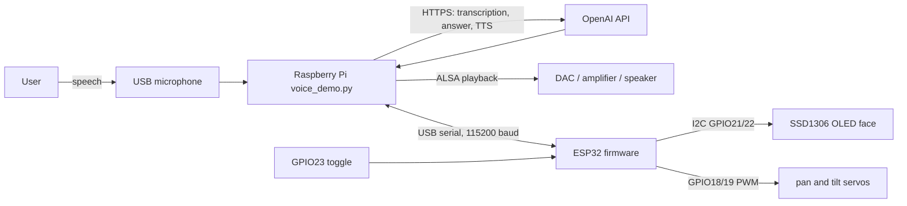

# Leo Buddy — AI-Powered Voice Assistant Robot

Leo Buddy is a Raspberry Pi voice assistant paired with an ESP32-controlled
animated face. A physical switch starts a conversation; the Pi captures and
transcribes speech, requests an AI response, and plays spoken audio. The ESP32
drives the OLED expressions and two small servos.

This release-preparation copy is based on the project files in the owner's
working directory. The owner has reported successful physical operation of the
voice workflow, OLED animation, toggle, and servos. Those results have not been
independently reproduced in this development environment; see
[`docs/release_audit.md`](docs/release_audit.md).

## Features implemented in source

- Five face states: `IDLE`, `LISTENING`, `THINKING`, `SPEAKING`, and `ERROR`.
- Autonomous, randomized eyelid animation and subtle gaze movement in the
  U8g2-based ESP32 sketch.
- GPIO23 debounced edge handling; either edge while ESP32 is IDLE reports a
  session request to the Pi.
- Two servo outputs with bounded 85–95° commands and state-associated poses.
- Newline-delimited USB serial at 115200 baud; the Pi sends states and `SYNC`,
  and the ESP32 reports switch-level sync and edge events.
- Pi-side voice capture, speech transcription, response generation, TTS,
  playback, follow-up turns, a per-listening 10-second speech-onset timeout,
  and local SQLite reminders.
- Optional systemd startup so the Pi boots into IDLE and waits for a switch.

The Pi needs internet access and an OpenAI API key for transcription, answer
generation, and speech synthesis. This project is not an offline assistant.
API usage may incur provider charges. The source currently configures the
`gpt-transcribe`, `gpt-4o-mini`, and `gpt-4o-mini-tts` model identifiers with the
Cedar voice; provider availability and terms can change.

## Hardware and software at a glance

Owner-reported hardware: Raspberry Pi 4 Model B Rev 1.5, ESP32-WROOM-32 Dev
Module, 128×64 SSD1306 OLED at `0x3C`, two SG90 micro servos, a toggle switch,
USB microphone, and audio output hardware. Exact audio amplifier/speaker models
and the servo supply model are not recorded.

The release firmware expects OLED SDA GPIO21/SCL GPIO22, pan servo GPIO18, tilt
servo GPIO19, and switch GPIO23. The application communicates with the ESP32
over USB serial, not the Pi's GPIO UART. See the
[`wiring guide`](docs/wiring_guide.md) for verification notes and safety.

## Architecture



## Repository layout

```text
voice_demo.py                 Pi conversation/session controller
reminder_*.py                 local reminder storage and parsing
run_voice_demo.sh             manual launcher and environment setup
firmware/LeoBuddy/LeoBuddy.ino ESP32 Arduino IDE sketch
tests/                        software tests using mocks/PTY fixtures
deploy/                       systemd unit example (edit before installing)
docs/                         setup, architecture, wiring, release notes
```

This curated copy includes only the firmware candidate whose `LEO:ANIM` and
switch diagnostic strings match the owner's Serial Monitor photo. It is copied
unchanged from `esp32_tests/leo_deskbuddy_open_source_eyes/` in the working
folder. The owner confirms that the eye animation was adapted from
[`playfultechnology/esp32-eyes`](https://github.com/playfultechnology/esp32-eyes).
This is the best-supported release candidate, not independent proof of the
exact binary currently flashed on the device.

## Quick start on Raspberry Pi OS

1. Install Python 3.10 or newer, `python3-venv`, `alsa-utils`, `ffmpeg`, and
   `mpg123`. `ffprobe` is included with FFmpeg on typical Debian-based systems.
2. In this repository, create a virtual environment and install Python deps:

   ```bash
   python3 -m venv .venv
   .venv/bin/python -m pip install -r requirements.txt
   ```

3. Configure `OPENAI_API_KEY` privately. The existing launcher reads it from
   the environment or a double-quoted `export OPENAI_API_KEY="..."` line in
   `~/.bashrc`. Do not commit the real key.
4. Check the microphone with `arecord -l`; set `LEO_MIC_DEVICE` if the source
   device differs from the default `plughw:CARD=Device,DEV=0`.
5. Upload the ESP32 sketch as described in
   [`docs/setup_guide.md`](docs/setup_guide.md), close Arduino Serial Monitor,
   then connect the ESP32 USB cable to the Pi.
6. Start manually with `./run_voice_demo.sh`, or set up the optional systemd
   service described in the setup guide.

The app starts in `IDLE`; it does not greet at boot. One genuine debounced
GPIO23 edge starts a session and greeting. Each completed answer returns to
`LISTENING` for a follow-up. Ten seconds without speech onset during a
listening window ends the session and returns to `IDLE`.

## Build and test

Python tests use `unittest` and mock API/audio calls; they do not prove that a
physical microphone, speaker, serial cable, OLED, switch, or servo works.

```bash
.venv/bin/python -m unittest discover -s tests -v
bash -n run_voice_demo.sh
```

The ESP32 sketch targets Arduino **ESP32 Dev Module** (`esp32:esp32:esp32`).
Install the ESP32 Arduino core and U8g2 library as described in the setup
guide. No firmware upload is performed by these instructions.

## Safety and limitations

- Power servos from an appropriately regulated external 5 V supply sized for
  both motors; join that supply's ground to ESP32 GND. Never power them from
  the ESP32 3.3 V pin. Verify mechanical clearance before operation.
- The switch-to-GND wiring and `INPUT_PULLUP` behavior must match the assembled
  circuit. Do not wire 5 V to the ESP32 GPIO.
- Voice recognition, answer generation, and TTS require network and API access.
- OLED animation and servo motion have owner-reported physical evidence, but
  this release preparation did not run on the assembled hardware.
- The ESP32 firmware is marked GPL-3.0-only with upstream attribution. The
  Raspberry Pi application has no declared license yet; see
  [`docs/license_and_credits.md`](docs/license_and_credits.md) and the
  [dependency license inventory](docs/dependencies_and_licenses.md).
- No project photos or demo video were present in the audited project tree.

## Project media

Add real, publication-authorized photographs and a demonstration video after
review. The shot list is in [`docs/media_plan.md`](docs/media_plan.md). Do not
publish private voice recordings or generated runtime audio.

## License

The adapted ESP32 firmware is distributed under GPL-3.0-only; its full license
text and upstream attribution are in `firmware/LeoBuddy/`. The Raspberry Pi
Python files remain without an assigned license until their ownership and
license are separately confirmed. The repository-wide release is not ready
until that decision is made. See
[`docs/license_and_credits.md`](docs/license_and_credits.md).

## Credits

The ESP32 eye-animation firmware is adapted from
[`playfultechnology/esp32-eyes`](https://github.com/playfultechnology/esp32-eyes),
whose repository is marked GPL-3.0. The upstream example credits Alastair
Aitchison / Playful Technology. The original
Raspberry Pi AI DeskBuddy reference is
[`sparklabhqx/RPI_AI_DeskBuddy_v.1.0`](https://github.com/sparklabhqx/RPI_AI_DeskBuddy_v.1.0);
its visible root file listing does not show a license file. It uses Pico-specific
firmware and wiring, so it is not the ESP32 pinout used here.

## Publication status

This folder is a local, curated Git repository prepared for review. It has no
remote and has not been pushed. Resolve the license/provenance decision, review
the staged files and media, then follow
[`docs/github_linkedin_guide.md`](docs/github_linkedin_guide.md).
