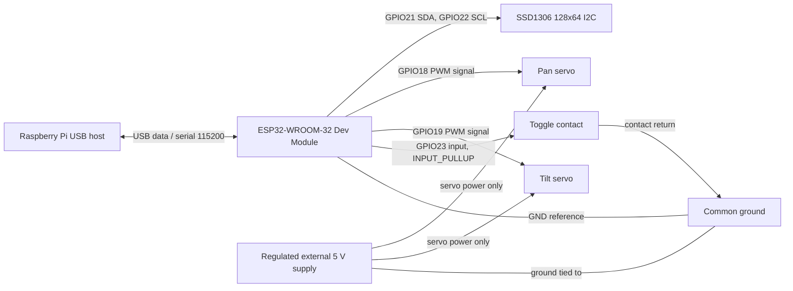

# Wiring guide and verification status

The assignments below match the selected ESP32 source and the owner's
hardware reports. They are not a substitute for checking labels, module
voltage ratings, or continuity on the assembled robot. The original upstream
repository is Pico-based; do not copy its GPIO assignments into this ESP32
build.

## Signal/power map

| From | To | Evidence / note |
|---|---|---|
| ESP32 GPIO21 (SDA) | OLED SDA | Firmware uses GPIO21; owner reports this wiring. |
| ESP32 GPIO22 (SCL) | OLED SCL | Firmware uses GPIO22; owner reports this wiring. |
| ESP32 3.3 V or suitable module supply | OLED VCC | Exact OLED breakout voltage/rating is not documented; follow the actual module marking/datasheet. Do not assume every breakout is 5 V tolerant. |
| ESP32 GND | OLED GND | Required I2C reference; owner-reported connection. |
| ESP32 GPIO18 | Pan servo signal | Firmware constrains angle commands to 85–95°. |
| ESP32 GPIO19 | Tilt servo signal | Firmware constrains angle commands to 85–95°. |
| Regulated external servo 5 V | Both servo red/power leads | Size supply for both motors' simultaneous startup/stall current using the actual servo datasheet. Do not use ESP32 3.3 V. |
| External servo supply GND | ESP32 GND | Common ground required for PWM reference. |
| ESP32 GPIO23 | One switch contact | Firmware configures `INPUT_PULLUP`; assumed switch contact to GND. |
| Other switch contact | ESP32 GND | If wired this way, open reads HIGH and closed reads LOW. Owner reports switch transitions were observed. |
| Raspberry Pi USB host | ESP32 USB connector | Current Pi control/data link and ESP32 USB serial at 115200 baud. No direct Pi GPIO UART TX/RX wires are part of this release. |

The physical board orientation, OLED VCC rating, external servo supply model,
and exact power distribution wiring have not been independently inspected.

## Functional connection diagram

This is a source-based functional diagram, not a PCB schematic. The GPIO23
contact-to-ground arrangement is conditional on the described wiring. Never
apply 5 V to ESP32 GPIO pins. Keep servo supply current out of the ESP32 3.3 V
rail; verify the external supply is appropriate before sustained motion.
